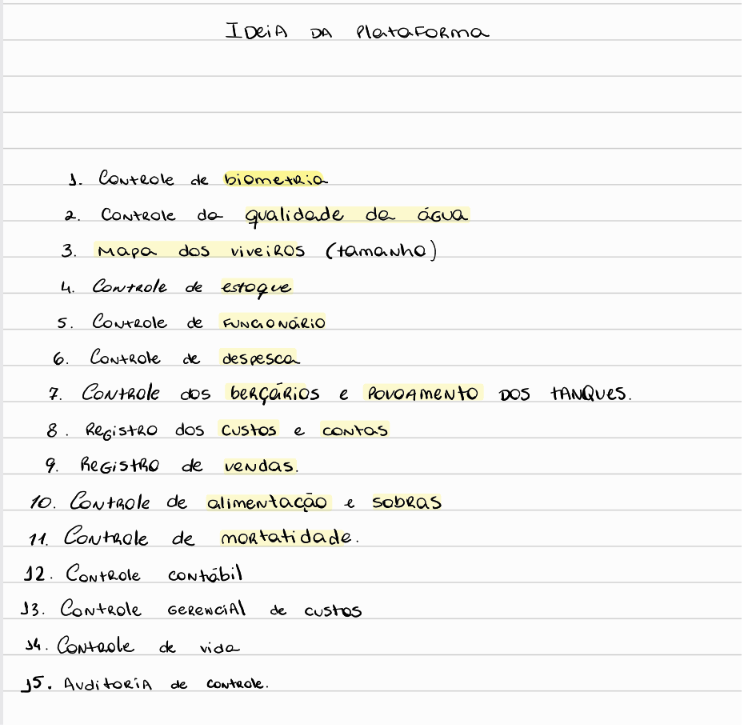
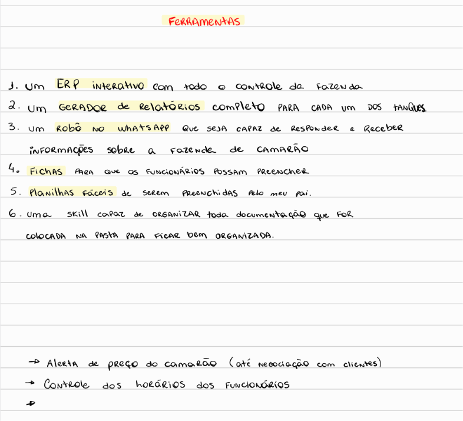
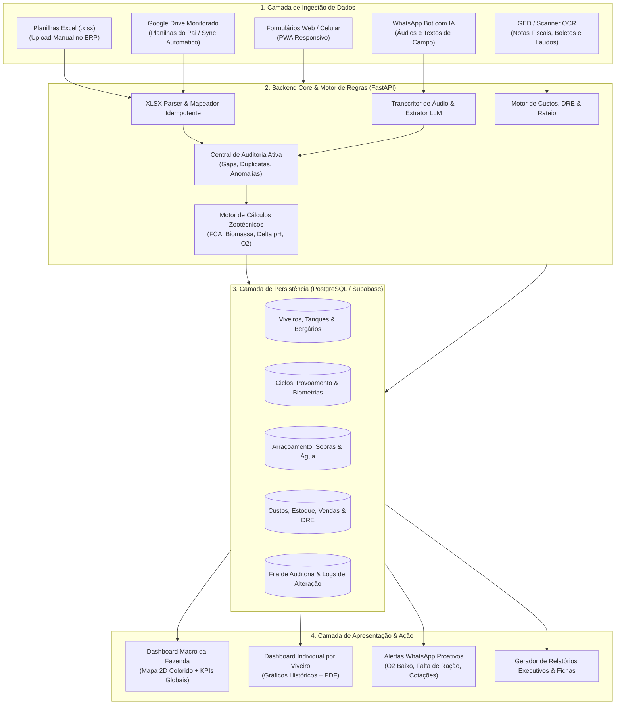
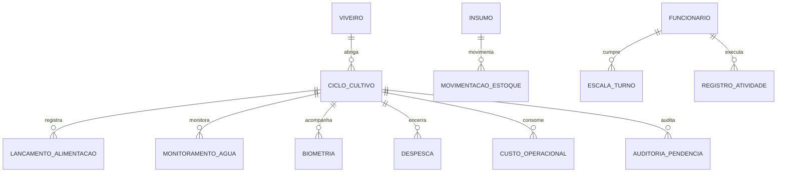
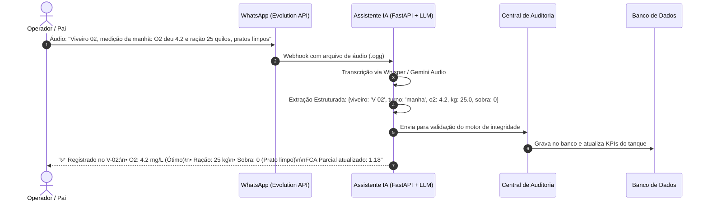
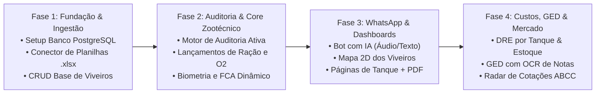

# 🦐 Plano Diretor de Arquitetura e Engenharia: ERP Carcinicultura

**Fazenda de Camarão Marinho (*Litopenaeus vannamei*) — Ceará-Mirim/RN**  
*Documento de Especificação Técnica, Arquitetura de Software e Roadmap de Implementação*

---

## 📌 1. Visão Geral e Objetivos do Sistema

Projetar a arquitetura completa de um sistema **ERP Web Integrado (PWA)** especializado em carcinicultura intensiva e semi-intensiva para a fazenda em Ceará-Mirim/RN. O sistema conecta o trabalho prático de campo (realizado pelo pai e colaboradores) à inteligência zootécnica e financeira executiva (gerida pelo Leonardo).

O ERP incorpora os **15 módulos fundamentais** e as **ferramentas estratégicas** mapeadas nos manuscritos originais do projeto, combinando:
1. **Ingestão Híbrida de Dados:** Aceita digitação direta em telas web/mobile responsivas, upload manual de planilhas `.xlsx` já existentes e sincronização contínua com pastas monitoradas do Google Drive.
2. **Central de Auditoria Ativa (Data Quality & Consistency Engine):** Identificação e tratamento automático de dias esquecidos, lançamentos duplicados e anomalias zootécnicas (ex: O2 crítico, desvios de consumo de ração, inconsistências de FCA).
3. **Assistente WhatsApp com IA (Áudio e Texto):** Canal prático para o operador/pai enviar dados de campo por mensagem de voz ou texto informal, consultar status dos tanques e receber alertas proativos 24/7.
4. **Dashboards Interativos em Duas Camadas:** Painel Macro da Fazenda (com mapa visual colorido dos viveiros e KPIs consolidados) e Páginas Analíticas por Viveiro (com curvas zootécnicas e exportação de relatórios em PDF de alta resolução).
5. **Módulo GED com OCR & Radar de Mercado:** Triagem automática de notas fiscais, boletos e laudos ambientais, combinada ao monitoramento contínuo de preços de camarão (ABCC/regional) para negociação assertiva com compradores.
6. **Gestão Operacional de Campo:** Cadastro de colaboradores, escalas de turnos diurnos e de vigia noturno de oxigênio, com controle ágil de atividades.

---

## 🖼️ 2. Mapeamento dos Manuscritos Originais

O planejamento estruturou-se a partir dos requisitos levantados nas anotações originais da fazenda:


*Figura 1: Módulos 1 a 15 do ERP da Fazenda (Manuscritos Originais).*


*Figura 2: Ferramentas Estratégicas e Recursos de Campo (Manuscritos Originais).*

---

## 🏛️ 3. Decisões Arquiteturais Consolidadas

> **Definições Estratégicas Selecionadas na Rodada de Alinhamento:**
> 1. **Plataforma:** Aplicação Web Responsiva em Nuvem (Frontend Next.js/React + Backend Python/FastAPI + Banco de Dados PostgreSQL hospedado no Supabase).
> 2. **Ingestão:** Híbrida (Upload direto de planilhas `.xlsx`, integração com Google Drive e formulários web/mobile).
> 3. **Auditoria:** Fila de Pendências Ativa com ações de 1 clique ("Manter Recente", "Mesclar", "Justificar", "Preencher Lacuna").
> 4. **WhatsApp Bot:** Assistente inteligente multimodal (processa texto e áudio de campo via Whisper/Gemini e API de WhatsApp Web/Evolution API).
> 5. **Dashboards:** Duas camadas (Visão Macro com Mapa Interativo dos Viveiros + Visão Micro por Viveiro com relatórios em PDF).
> 6. **Documentos & Mercado:** GED com OCR de notas/laudos associados aos viveiros + Radar de Cotações ABCC integrado.
> 7. **Equipe:** Gestão operacional leve de escalas, vigia noturno e atividades de campo.

---

## 🏗️ 4. Proposta de Arquitetura do Sistema



---

## 🗄️ 5. Modelo de Dados Relacional (PostgreSQL / Supabase)

O esquema relacional é estruturado para garantir integridade referencial, rastreabilidade e auditoria nativa em todas as operações:



### Estrutura das Tabelas Principais

#### `fazendas` (Módulo Multi-Tenant / Gestão Multi-Fazendas)
* `id`: UUID (Chave primária).
* `codigo`: VARCHAR(20) UNIQUE (ex: 'FAZ_ARRENDADA', 'FAZ_HAKKA').
* `nome`: VARCHAR(100) (ex: 'Fazenda Arrendada - Ceará-Mirim', 'Fazenda Hakka - Própria').
* `tipo_propriedade`: ENUM ('arrendada', 'propria').
* `municipio_uf`: VARCHAR(50) (Padrão: 'Ceará-Mirim/RN').
* `area_total_ha`: NUMERIC(8,2).
* `licenca_operacao_idema`: VARCHAR(50).
* `status`: ENUM ('ativa', 'em_implantacao', 'inativa').
* `data_cadastro`: TIMESTAMP WITH TIME ZONE.

> [!NOTE] Segregação Multi-Tenant Rigorosa
> Todas as tabelas operacionais e financeiras abaixo possuem a chave estrangeira `fazenda_id: UUID (FK -> fazendas.id) NOT NULL`. Isso garante isolamento total entre a **Fazenda Arrendada** (15 tanques em operação) e a **Fazenda Hakka** (em configuração), viabilizando DREs contábeis segregados por contrato e consolidação financeira do grupo.

#### `viveiros` (Cadastro Físico e Topografia)
* `id`: UUID (Chave primária).
* `fazenda_id`: UUID (FK -> `fazendas.id` - Segregação Multi-Fazenda).
* `codigo`: VARCHAR(10) (ex: 'V-01', 'V-02', 'BER-01').
* `tipo`: ENUM ('engorda', 'bercario', 'bacia_decantacao', 'reservatorio').
* `area_m2`: NUMERIC(10,2) (Área em metros quadrados).
* `area_ha`: NUMERIC(6,4) (Área em hectares calculada).
* `profundidade_media_m`: NUMERIC(3,2).
* `volume_m3`: NUMERIC(12,2).
* `capacidade_aeradores_cv`: NUMERIC(4,1).
* `coordenadas_mapa_svg`: JSONB (Polígono para o mapa interativo).
* `status_atual`: ENUM ('vazio_sanitario', 'preparo_solo', 'abastecendo', 'em_cultivo', 'despescando').

#### `ciclos_cultivo` (O Ciclo Biológico de Cada Tanque)
* `id`: UUID (Chave primária).
* `viveiro_id`: UUID (FK -> `viveiros.id`).
* `numero_ciclo`: INTEGER (ex: Ciclo 12 do V-01).
* `data_povoamento`: DATE.
* `quantidade_pl_estocada`: INTEGER (Total de pós-larvas).
* `estagio_pl`: VARCHAR(20) (ex: 'PL-10', 'PL-12').
* `densidade_inicial_pl_m2`: NUMERIC(5,2).
* `fornecedor_pl`: VARCHAR(100).
* `salinidade_aclimatacao`: NUMERIC(4,1).
* `data_despesca_prevista`: DATE.
* `data_despesca_real`: DATE (NULL enquanto em andamento).
* `status`: ENUM ('ativo', 'finalizado', 'interrompido').

#### `lancamentos_alimentacao` (Consumo Diário e Sobras)
* `id`: UUID (Chave primária).
* `ciclo_id`: UUID (FK -> `ciclos_cultivo.id`).
* `data`: DATE.
* `dia_ciclo`: INTEGER.
* `kg_manha`: NUMERIC(6,2).
* `kg_tarde`: NUMERIC(6,2).
* `kg_noite`: NUMERIC(6,2).
* `kg_total_dia`: NUMERIC(6,2) GENERATED ALWAYS AS (COALESCE(kg_manha,0) + COALESCE(kg_tarde,0) + COALESCE(kg_noite,0)) STORED.
* `sobra_bandeja_nivel`: SMALLINT (0 = Limpo, 1 = Pouca sobra, 2 = Média sobra, 3 = Não comeu).
* `tipo_racao`: VARCHAR(50) (ex: '35% Proteína 1.6mm').
* `funcionario_id`: UUID (FK -> `funcionarios.id`).
* `origem_dado`: ENUM ('web_manual', 'planilha_sync', 'whatsapp_bot').
* `hash_registro`: VARCHAR(64) UNIQUE (Hash `ciclo_id + data` para auditoria anti-duplicidade).

#### `monitoramentos_agua` (Parâmetros Físico-Químicos)
* `id`: UUID (Chave primária).
* `ciclo_id`: UUID (FK -> `ciclos_cultivo.id`).
* `data`: DATE.
* `hora_medicao_manha`: TIME (05:00 - 06:00).
* `oxigenio_manha_mg_l`: NUMERIC(4,2).
* `temperatura_manha_c`: NUMERIC(4,1).
* `ph_manha`: NUMERIC(4,2).
* `hora_medicao_noite`: TIME (21:00 - 22:30).
* `oxigenio_noite_mg_l`: NUMERIC(4,2).
* `salinidade_ppt`: NUMERIC(4,1).
* `ph_tarde`: NUMERIC(4,2).
* `transparencia_secchi_cm`: SMALLINT.
* `amonia_total_mg_l`: NUMERIC(4,2) (Semanal).
* `nitrito_mg_l`: NUMERIC(4,2) (Semanal).
* `alcalinidade_mg_l`: NUMERIC(6,2).
* `alerta_asfixia`: BOOLEAN GENERATED ALWAYS AS (oxigenio_manha_mg_l < 3.0 OR oxigenio_noite_mg_l < 3.0) STORED.

#### `biometrias` (Crescimento e Projeções)
* `id`: UUID (Chave primária).
* `ciclo_id`: UUID (FK -> `ciclos_cultivo.id`).
* `data_amostragem`: DATE.
* `dia_ciclo`: INTEGER.
* `amostras_pesadas_qtd`: INTEGER (ex: 100 camarões).
* `peso_medio_g`: NUMERIC(5,2).
* `ganho_peso_semanal_g`: NUMERIC(4,2).
* `sobrevivencia_estimada_pct`: NUMERIC(5,2).
* `biomassa_estimada_kg`: NUMERIC(10,2).
* `fca_parcial`: NUMERIC(4,2).
* `taxa_alimentacao_pct_biomassa`: NUMERIC(4,2).

#### `despescas_vendas` (Faturamento e Consolidação Final)
* `id`: UUID (Chave primária).
* `ciclo_id`: UUID (FK -> `ciclos_cultivo.id`).
* `data_despesca`: DATE.
* `biomassa_despescada_kg`: NUMERIC(10,2).
* `gramatura_final_media_g`: NUMERIC(5,2).
* `classificacao_tamanho`: VARCHAR(30) (ex: '80/100', '10g-12g', '15g+').
* `sobrevivencia_real_final_pct`: NUMERIC(5,2).
* `fca_final_ciclo`: NUMERIC(4,2).
* `preco_venda_kg`: NUMERIC(6,2).
* `faturamento_bruto`: NUMERIC(12,2).
* `comprador_nome`: VARCHAR(150).
* `romaneio_numero`: VARCHAR(50).

#### `auditoria_pendencias` (Motor de Integridade)
* `id`: UUID (Chave primária).
* `tipo_inconsistencia`: ENUM ('dia_faltante', 'duplicidade_conflitante', 'o2_critico', 'fca_anomalo', 'estoque_divergente', 'sobra_excessiva').
* `entidade_afetada`: VARCHAR(50) (ex: 'lancamentos_alimentacao', 'monitoramentos_agua').
* `registro_origem_id`: UUID (NULL se for dia esquecido).
* `viveiro_codigo`: VARCHAR(10).
* `data_referencia`: DATE.
* `severidade`: ENUM ('baixa', 'media', 'alta', 'critica').
* `descricao_problema`: TEXT.
* `payload_conflito_json`: JSONB (Dados comparativos antes/depois ou opções de mesclagem).
* `status`: ENUM ('pendente', 'resolvido', 'ignorado_justificado').
* `acao_resolucao`: VARCHAR(100).
* `resolvido_por`: VARCHAR(100).
* `resolvido_em`: TIMESTAMP WITH TIME ZONE.

---

## 🛡️ 6. Motor de Auditoria Ativa (Data Quality & Consistency Engine)

O grande diferencial do ERP da fazenda é atuar como um **Zootécnico e Auditor Digital em tempo real**. O motor é acionado em quatro momentos:
1. Ao salvar um formulário manual.
2. Ao receber uma linha via sincronização da planilha Excel.
3. Ao processar um áudio do WhatsApp.
4. Em rotina automática de fechamento diário (às 23h59).

### 1. Regras do Detector de Conflitos e Duplicatas

```python
# Algoritmo de Auditoria de Duplicidades e Conflitos
def auditar_duplicidade_arraçoamento(novo_registro, registros_existentes):
    """
    Compara o novo lançamento com o histórico do mesmo viveiro e data.
    Retorna pendência de auditoria caso encontre divergência.
    """
    duplicatas = [r for r in registros_existentes 
                  if r.data == novo_registro.data and r.ciclo_id == novo_registro.ciclo_id]
    
    if not duplicatas:
        return None  # Registro íntegro e inédito
    
    registro_atual = duplicatas[0]
    
    # Se os valores forem rigorosamente idênticos: descarte silencioso seguro
    if (registro_atual.kg_total_dia == novo_registro.kg_total_dia and 
        registro_atual.sobra_bandeja_nivel == novo_registro.sobra_bandeja_nivel):
        return {"status": "ignorar_identico", "mensagem": "Lançamento idêntico já cadastrado."}
        
    # Se os valores divergirem: CRIAÇÃO DE PENDÊNCIA NA AUDITORIA
    return {
        "status": "conflito_pendente",
        "tipo": "duplicidade_conflitante",
        "severidade": "alta",
        "descricao": f"Valores divergentes no dia {novo_registro.data}: Já constava {registro_atual.kg_total_dia}kg, recebido {novo_registro.kg_total_dia}kg.",
        "payload": {
            "valor_existente": registro_atual.to_dict(),
            "valor_novo": novo_registro.to_dict(),
            "acoes_possiveis": [
                {"id": "manter_novo", "label": "Substituir pelo novo lançamento"},
                {"id": "manter_antigo", "label": "Manter o valor já existente"},
                {"id": "somar", "label": "Somar as duas quantidades (turnos separados)"}
            ]
        }
    }
```

### 2. Regras do Detector de Lacunas (Dias Esquecidos)

* **Gatilho:** Diariamente às 23h59 ou ao abrir a Visão Macro.
* **Lógica:** Para cada viveiro em status `'em_cultivo'`, verifica se `COUNT(lancamentos)` entre `data_inicio` e `hoje` é igual à quantidade de dias decorridos.
* **Ação:** Cria um card de pendência: *"⚠️ Viveiro 03: Não foi registrado o arraçoamento nem a medição de oxigênio de ontem (18/10). Clique para preencher agora ou justificar 'Vazio/Seco'."*

### 3. Regras de Anomalias Zootécnicas e Operacionais

| Gatilho de Alerta | Condição Matemática | Severidade | Ação Imediata do Sistema |
| :--- | :--- | :--- | :--- |
| **Anóxia / Hipóxia Crítica** | $O_2 < 3.0 \text{ mg/L}$ | 🚨 CRÍTICA | Dispara alerta sonoro no painel e mensagem de emergência no WhatsApp do vigia/gerente. |
| **Pico de Amônia Tóxica** | $NH_3 > 0.1 \text{ mg/L}$ | ⚠️ ALTA | Sugere redução imediata de 50% no arraçoamento e aplicação de probióticos/renovação. |
| **Sobra Crônica em Bandejas** | Sobra Nível 3 por 2 dias seguidos | ⚠️ ALTA | Bloqueia aumento de arraçoamento e sinaliza risco de deterioração do solo. |
| **FCA Explosivo Parcial** | $FCA > 1.8$ com $DDC < 60$ | ⚠️ ALTA | Sinaliza suspeita de mortalidade oculta (mionecrose) ou desperdício/desvio de ração. |
| **Delta pH Elevado** | $pH_{\text{Tarde}} - pH_{\text{Manhã}} > 0.8$ | 🟡 MÉDIA | Alerta desequilíbrio no bloom de algas e queda iminente de oxigênio na madrugada. |

---

## 📥 7. Ingestão Híbrida: Conector de Planilhas Excel (.xlsx)

O ERP possui um módulo especializado em processar as planilhas da fazenda desenvolvidas com a skill `planilhas-carcinicultura`.

### Fluxo de Sincronização:
1. **Pasta Google Drive Compartilhada:** O pai ou o operador edita a planilha em seu computador ou tablet. O Google Drive sincroniza o arquivo `.xlsx` na nuvem.
2. **Watcher / Webhook:** O backend do ERP monitora alterações de data/hora nos arquivos de controle (ex: `Controle_Alimentacao_e_Biometria.xlsx` e `Controle_Qualidade_Agua.xlsx`).
3. **Parser OpenXML Idempotente:** O script Python lê as abas de cada viveiro (`V-01`, `V-02`, etc.), pula as linhas protegidas de banner e cabeçalho (linhas 1 a 9) e itera da linha 10 até a última preenchida.
4. **Cálculo de Hash por Linha:** Cada linha recebe um hash SHA-256 (`viveiro + data + kg + o2`). Apenas linhas novas ou alteradas são enviadas para o motor de auditoria, evitando reprocessamentos desnecessários.

```python
# Módulo de Leitura e Parsing de Planilhas Existentes
import openpyxl
from datetime import date

def extrair_dados_planilha_alimentacao(caminho_xlsx):
    wb = openpyxl.load_workbook(caminho_xlsx, data_only=True)
    registros_para_auditoria = []
    
    for aba_nome in wb.sheetnames:
        if not aba_nome.startswith("V-"):  # Filtra abas dos viveiros
            continue
            
        ws = wb[aba_nome]
        codigo_viveiro = aba_nome
        
        # Leitura da tabela a partir da linha 10 (conforme padrão do Design System)
        for row in range(10, ws.max_row + 1):
            data_val = ws.cell(row=row, column=2).value
            if not data_val:
                continue
                
            dia_ciclo = ws.cell(row=row, column=1).value
            kg_manha = ws.cell(row=row, column=3).value or 0
            kg_tarde = ws.cell(row=row, column=4).value or 0
            kg_noite = ws.cell(row=row, column=5).value or 0
            sobra = ws.cell(row=row, column=7).value
            
            registros_para_auditoria.append({
                "viveiro": codigo_viveiro,
                "data": data_val if isinstance(data_val, date) else data_val.date(),
                "dia_ciclo": dia_ciclo,
                "kg_manha": float(kg_manha),
                "kg_tarde": float(kg_tarde),
                "kg_noite": float(kg_noite),
                "sobra_nivel": int(sobra) if sobra is not None else 0
            })
            
    return registros_para_auditoria
```

---

## 🤖 8. Robô Assistente no WhatsApp (IA Multimodal)

O WhatsApp atua como a interface de campo mais ágil para o pai e para a equipe de funcionários, eliminando a barreira do preenchimento de telas complexas.



### Funcionalidades do Assistente WhatsApp:
1. **Entrada de Dados por Áudio e Texto:** O operador manda mensagens informais; o assistente extrai valores numéricos, datas e viveiros e confirma o recebimento em linguagem clara.
2. **Consultas Rápidas no Bolso:**
   * *"Como tá o Viveiro 01?"* $\rightarrow$ Retorna dias de ciclo, biometria atual, peso médio, FCA e última leitura de oxigênio.
   * *"Quantos sacos de ração tem no galpão?"* $\rightarrow$ Retorna saldo em estoque e dias de autonomia estimados.
   * *"Qual a cotação do camarão de 12g hoje?"* $\rightarrow$ Retorna o último levantamento da ABCC e do mercado regional.
3. **Alertas Proativos Críticos:**
   * Alerta de O2 baixo na madrugada disparado diretamente para o vigia.
   * Aviso de estoque de ração atingindo o ponto de pedido (< 7 dias de consumo).

---

## 📊 9. Dashboards Interativos em Duas Camadas

### Camada 1: Visão Macro da Fazenda (Painel Executivo)
* **Mapa 2D Dinâmico dos Viveiros:** Representação gráfica dos tanques com código de cores em tempo real:
  * 🟢 **Verde:** Parâmetros ótimos (O2 estável, FCA dentro da meta, bandejas limpas).
  * 🟡 **Amarelo:** Atenção (sobras registradas nas últimas 24h ou O2 entre 3.0 e 3.5 mg/L).
  * 🔴 **Vermelho:** Alerta Crítico (O2 < 3.0 mg/L, dia sem alimentação lançada ou suspeita de doença).
  * ⚪ **Cinza:** Viveiro vazio, em preparo de solo ou bacia de decantação.
* **Cards de KPIs Consolidados:**
  * **Biomassa Total em Cultivo (kg):** Estimativa consolidada de toda a fazenda.
  * **FCA Médio Ponderado da Safra:** Desempenho geral da conversão alimentar.
  * **Consumo Diário de Ração (kg/dia):** Total fornecido hoje vs meta programada.
  * **Autonomia de Ração:** Dias restantes até esgotamento do estoque atual.
* **Inbox de Pendências de Auditoria:** Painel expansível exibindo incongruências para resolução imediata com botões de 1 clique.

### Camada 2: Visão Micro (Página Individual do Viveiro)
* **Cabeçalho Zootécnico:** Código do viveiro, ciclo atual, data de povoamento, DDC (dias de cultivo), densidade e biomassa projetada.
* **Gráficos Interativos (Recharts / Chart.js):**
  1. *Curva de Crescimento:* Peso médio semanal real vs Curva teórica esperada.
  2. *Tendência de Oxigênio Diurno/Noturno:* Histórico de medições com linha de corte crítico em 3.0 mg/L.
  3. *Consumo de Ração vs Ganho de Biomassa:* Evolução do FCA parcial ao longo dos dias.
* **DRE / Custos Acumulados do Tanque:** Custo de pós-larvas, ração consumida, energia alocada e insumos de preparo.
* **Botão "Exportar Relatório Executivo PDF":** Gera instantaneamente o fechamento consolidado do viveiro pronto para impressão ou envio por e-mail/WhatsApp.

---

## 📁 10. Módulo GED Inteligente & Radar de Mercado

### 1. Gestão Eletrônica de Documentos (GED) com OCR
* **Pasta de Despejo Monitorada:** O usuário deposita PDFs ou fotos de comprovantes na pasta da fazenda (Google Drive).
* **Processamento por IA:**
  * Identifica a natureza do documento: Nota Fiscal de Ração, Fatura de Energia (Cosern/Neoenergia), Romaneio de Despesca, Comprovante de Pagamento de Diária, Laudo de Monitoramento de Água (IDEMA-RN).
  * Extrai: Data, Valor Total, Quantidade de Sacos/Quilos, Lote, Vencimento e Favorecido.
  * Classifica automaticamente no módulo financeiro e gera a movimentação correspondente no estoque de insumos.
  * Renomeia e arquiva o arquivo original na estrutura padrão: `FAZENDA/DOCUMENTOS/<ANO>/<CATEGORIA>/`.

### 2. Radar de Mercado e Apoio à Negociação
* **Monitoramento Ativo:** Conecta-se às tabelas periódicas da ABCC e cotações de atacado regional no RN/CE.
* **Simulador de Despesca Ótima:** Cruza o custo acumulado do viveiro (R\$/kg produzido), o ganho semanal de peso atual e a cotação da gramatura no mercado. Recomenda o momento ideal de despesca antes que o FCA elevado supere o ganho financeiro por grama adicional.

---

## 👥 11. Módulo de Funcionários & Turnos de Campo

* **Cadastro de Colaboradores:** Nome, função (arraçoador, vigia noturno, operador de máquinas), contato de WhatsApp e remuneração (salário mensal ou diária).
* **Escala de Turnos Operacionais:**
  * *Turno Diurno:* Arraçoamento em 3 horários (07h00, 11h00, 16h00), checagem de bandejas, aplicação de probióticos e calagem.
  * *Turno Noturno (Vigia de Oxigênio):* Rondas às 22h00, 02h00 e 05h00 para medição de O2 e verificação do acionamento dos aeradores.
* **Check-in Ágil:** Registro de presença e início de turno com 1 clique no WhatsApp ou no painel do ERP.
* **Apontamento de Horas e Tarefas:** Vincula automaticamente as diárias e tarefas extras (ex: preparo de fundo do V-04) ao custo específico do viveiro beneficiado.

---

## 🗺️ 12. Roadmap de Implementação em Fases



### Detalhamento das Entregas por Fase:

* **Fase 1 — Fundação, Arquitetura e Ingestão de Planilhas (Semana 1-2):**
  - Configuração do repositório, backend FastAPI e banco PostgreSQL (Supabase).
  - Desenvolvimento do leitor/parser de planilhas Excel existentes (`Controle_Alimentacao_e_Biometria.xlsx` e `Controle_Qualidade_Agua.xlsx`).
  - Mapeamento inicial dos 15 tanques da fazenda.

* **Fase 2 — Motor de Auditoria Ativa e Regras Zootécnicas (Semana 3-4):**
  - Implementação da Central de Auditoria (detecção de duplicatas, gaps temporais e parâmetros críticos).
  - Interface Web PWA para formulários diários com validação preventiva.
  - Cálculos matemáticos zootécnicos padronizados (Biomassa, FCA, Taxa de Alimentação, delta pH).

* **Fase 3 — Dashboards Interativos e Assistente WhatsApp (Semana 5-6):**
  - Construção do Painel Macro da Fazenda com Mapa 2D SVG dos viveiros colorido por status.
  - Construção da Página Analítica individual por Viveiro com exportação de Relatório Executivo em PDF.
  - Conexão do bot de WhatsApp com transcrição de áudio e extração estruturada de parâmetros de campo.

* **Fase 4 — Financeiro, Estoque, GED e Radar de Mercado (Semana 7-8):**
  - Módulo de controle de estoque de ração (saldo de sacos, ponto de pedido, conciliação).
  - DRE e apuração de custo do kg de camarão por viveiro.
  - Triagem documental com OCR para notas fiscais e comprovantes.
  - Painel de Cotações da ABCC e calculadora de momento ótimo de despesca.

---

## 🧪 13. Plano de Verificação e Validação

### 1. Testes Automatizados de Engenharia
* **Testes Unitários do Parser de XLSX:** Executar scripts de ingestão contra as planilhas reais existentes na pasta `CAMARÃO/MODELOS DE CONTROLE/` para certificar que 100% dos dados históricos são importados sem truncamento.
* **Testes do Motor de Auditoria:** Inserir deliberadamente massa de dados sintética com duplicidades propositais, dias faltantes e valores fora de escala ($O_2 = 1.8$, $FCA = 3.5$) para garantir que todas as pendências sejam capturadas e classificadas com a severidade correta.
* **Testes de Fórmulas e Cálculos Zootécnicos:** Confrontar os cálculos do backend em Python com os resultados das planilhas auditadas da fazenda para assegurar precisão decimal absoluta.

### 2. Validação Manual e Operacional
* **Teste de Usabilidade Mobile para o Pai:** Validar a ergonomia de preenchimento dos formulários em smartphone simples, garantindo fontes legíveis e poucos cliques.
* **Teste de Campo do Robô no WhatsApp:** Enviar 10 mensagens de áudio gravadas em ambiente externo (com ruído de vento/motores) para testar a taxa de acerto da transcrição e extração de dados.
* **Inspeção Visual dos Relatórios em PDF:** Gerar relatórios de fechamento de viveiro e certificar que o layout atende aos padrões do Design System corporativo da fazenda.
